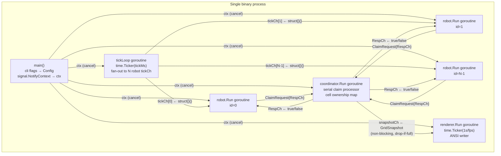

# Design Document — GoRobotControlDemo

**Version:** 1.0.0
**Date:** 2026-08-22
**Status:** Ready for Go Developer handoff
**SRS Version:** 1.0.0

---

## Table of Contents

1. [Architecture Overview](#1-architecture-overview)
2. [Package Breakdown](#2-package-breakdown)
3. [Key Interfaces and Types](#3-key-interfaces-and-types)
4. [Module / Directory Structure](#4-module--directory-structure)
5. [Concurrency Model](#5-concurrency-model)
6. [Visualization Subsystem](#6-visualization-subsystem)
7. [Shutdown Protocol](#7-shutdown-protocol)
8. [Design Decisions & Trade-offs](#8-design-decisions--trade-offs)
9. [Risks](#9-risks)
10. [Third-party Dependencies](#10-third-party-dependencies)
11. [Flags Back to Requirements Analyst](#11-flags-back-to-requirements-analyst)

---

## 1. Architecture Overview

The binary is a single process containing six classes of goroutine that communicate
exclusively through typed Go channels (cell-coordination layer) or a snapshot channel
guarded by a buffered send (visualization layer).



**Data flow summary**

| Direction | Channel | Type | Notes |
|-----------|---------|------|-------|
| tickLoop → robot | `tickCh[i]` | `chan struct{}` | one per robot, buf=1 |
| robot → coordinator | `claimCh` | `chan ClaimRequest` | shared, buf=N |
| coordinator → robot | `RespCh` (in request) | `chan bool` | one per in-flight request, buf=1 |
| coordinator → renderer | `snapshotCh` | `chan GridSnapshot` | buf=1, non-blocking send |

---

## 2. Package Breakdown

```
module: github.com/vlantonov/GoRobotControlDemo
```

### `cmd/robotdemo` — entry point

Responsibilities:
- Parse CLI flags via `internal/config`.
- Install OS signal handling with `signal.NotifyContext`.
- Construct and run `internal/simulation.Simulation`.
- Print errors to stderr and exit with the correct status code.

Exports: nothing (package `main`).

---

### `internal/config` — configuration

Responsibilities:
- Define `Config` (all runtime parameters in one value type).
- Parse `os.Args` with the standard `flag` package.
- Validate ranges (positive dimensions, robots ≤ width×height, positive fps/tick-ms).

Exports: `Config`, `Parse`.

---

### `internal/grid` — grid geometry and shared protocol types

Responsibilities:
- Define `Pos`, `Grid` (immutable geometry), `Command` (movement direction), `Cell`.
- Define the channel-protocol message types `ClaimRequest` and `GridSnapshot`.
  Placing protocol types here avoids an import cycle between `coordinator` and `robot`.
- Provide pure geometry helpers (`Contains`, `Neighbors`, `Apply`).

Exports: `Pos`, `Grid`, `Cell`, `Command` constants, `ClaimRequest`, `GridSnapshot`,
`New` (Grid constructor), `Contains`, `Neighbors`, `Apply`.

---

### `internal/coordinator` — cell-ownership arbiter

Responsibilities:
- Run as a single goroutine that serially processes all `ClaimRequest` messages.
- Maintain the authoritative cell-ownership map `map[grid.Pos]int`.
- Atomically release the robot's old cell and grant the new cell in one map update.
- Push a `GridSnapshot` to the renderer after every state change (non-blocking).

Exports: `Coordinator`, `New`, `(*Coordinator).Run`.

---

### `internal/robot` — robot goroutine

Responsibilities:
- Implement the random-walk-with-path-claiming movement strategy.
- Wait for a tick, shuffle the four cardinal directions, and attempt each direction
  in order via a `ClaimRequest`; stop at the first grant.
- If all directions are denied, remain stationary for that tick (FR-17).
- Respect context cancellation.

Exports: `Robot`, `New`, `(*Robot).Run`.

---

### `internal/simulation` — lifecycle orchestrator

Responsibilities:
- Validate config and allocate all channels, the grid, coordinator, robots, renderer.
- Assign distinct random starting positions (Fisher-Yates on a shuffled position list).
- Start goroutines (tick loop, coordinator, N robots, renderer) using `sync.WaitGroup`.
- Block in `Run` until `ctx` is done, then orchestrate the shutdown sequence.

Exports: `Simulation`, `New`, `(*Simulation).Run`.

---

### `internal/tui` — terminal renderer

Responsibilities:
- Save and restore the terminal state on entry/exit (via `golang.org/x/term`).
- On each render tick, drain the latest `GridSnapshot` from `snapshotCh` and
  overwrite the terminal region using ANSI escape sequences.
- Display: grid cells, current tick count, active robot count, FPS indicator.

Exports: `Renderer`, `New`, `(*Renderer).Run`, `(*Renderer).Restore`.

---

## 3. Key Interfaces and Types

All signatures below are pseudocode-level Go. Doc comments follow Go conventions.

### `internal/grid`

```go
// Pos is a zero-indexed (column, row) coordinate.
type Pos struct {
    Col int
    Row int
}

// Grid holds the immutable dimensions of the warehouse.
// All mutable cell state lives in the Coordinator.
type Grid struct {
    Width  int
    Height int
}

// Cell records the ownership of one grid position.
// Owner == -1 means unclaimed; Owner >= 0 is the robot ID holding the claim.
type Cell struct {
    Owner int
}

// Command encodes a cardinal movement direction.
type Command int

const (
    CmdNorth Command = iota // row - 1
    CmdSouth                // row + 1
    CmdEast                 // col + 1
    CmdWest                 // col - 1
)

// New returns a Grid. Returns error if width or height is not positive.
func New(width, height int) (Grid, error)

// Contains reports whether pos lies within the grid bounds.
func (g Grid) Contains(pos Pos) bool

// Neighbors returns the in-bounds orthogonal neighbors of pos (1–4 elements).
func (g Grid) Neighbors(pos Pos) []Pos

// Apply returns the Pos reached by taking cmd from pos, and whether
// the result is within the grid. The caller must check the bool before using the result.
func (g Grid) Apply(pos Pos, cmd Command) (Pos, bool)

// ClaimRequest is the message a robot sends to the coordinator to attempt an
// atomic release-old / claim-new move.
type ClaimRequest struct {
    RobotID int      // ID of the requesting robot
    From    Pos      // current (already-claimed) cell to release
    To      Pos      // desired (currently unclaimed) cell to claim
    RespCh  chan<- bool // coordinator writes true=granted, false=denied
}

// GridSnapshot is an immutable copy of the full grid state at one instant.
// Cells[row][col] holds -1 (empty) or the robot ID of the current occupant.
type GridSnapshot struct {
    Width        int
    Height       int
    Cells        [][]int
    Tick         uint64
    ActiveRobots int
}
```

### `internal/config`

```go
// Config holds all runtime parameters resolved from CLI flags.
type Config struct {
    Width   int // default 20
    Height  int // default 10
    Robots  int // default 5
    TickMs  int // default 100
    FPS     int // default 10
}

// Parse parses os.Args[1:], validates all fields, and returns a Config.
// Returns an error for invalid flag values; the error message is suitable for
// printing to stderr verbatim.
func Parse() (Config, error)
```

### `internal/coordinator`

```go
// Coordinator serialises all cell-claim and cell-release operations.
// It is the sole writer of the cell-ownership map.
type Coordinator struct { /* unexported */ }

// New constructs a Coordinator.
//   g          immutable grid dimensions
//   initialPos initialPos[i] is the starting position of robot i (pre-claimed)
//   claimCh    shared inbound claim channel; coordinator reads from it
//   snapshotCh coordinator writes state snapshots here (non-blocking, buf=1)
func New(
    g          grid.Grid,
    initialPos []grid.Pos,
    claimCh    <-chan grid.ClaimRequest,
    snapshotCh chan<- grid.GridSnapshot,
) *Coordinator

// Run processes ClaimRequest messages until ctx is cancelled, then drains any
// buffered requests (responding false to all) before returning.
func (c *Coordinator) Run(ctx context.Context)
```

### `internal/robot`

```go
// Robot is a warehouse robot that runs as an independent goroutine.
type Robot struct { /* unexported */ }

// New constructs a Robot.
//   id       unique identifier in [0, N)
//   start    initial grid position (already claimed in the coordinator)
//   g        grid bounds for neighbour generation
//   claimCh  shared coordinator channel (all robots share one)
//   tickCh   robot-specific tick channel; receives struct{}{} on each movement tick
func New(
    id      int,
    start   grid.Pos,
    g       grid.Grid,
    claimCh chan<- grid.ClaimRequest,
    tickCh  <-chan struct{},
) *Robot

// Run is the robot goroutine body. It blocks until ctx is done.
// On each tick the robot attempts to move using the random-walk-with-path-claiming
// strategy. If all in-bounds neighbors are denied, the robot waits one tick.
func (r *Robot) Run(ctx context.Context)
```

### `internal/tui`

```go
// Renderer renders grid snapshots to an ANSI terminal.
type Renderer struct { /* unexported */ }

// New constructs a Renderer that writes to w.
func New(w io.Writer) *Renderer

// Run reads from snapshotCh and redraws the terminal at up to fps frames per second
// until ctx is cancelled. It saves the cursor position on first render and uses
// ANSI escape sequences to overwrite in place.
func (r *Renderer) Run(ctx context.Context, snapshotCh <-chan grid.GridSnapshot, fps int)

// Restore resets the terminal (show cursor, reset colour, clear status line).
// Must be deferred by the caller immediately after calling Run in a goroutine.
func (r *Renderer) Restore()
```

### `internal/simulation`

```go
// Simulation owns the full goroutine fleet for one run.
type Simulation struct { /* unexported */ }

// New validates cfg, seeds initial robot positions, and allocates all channels,
// the grid, coordinator, robots, and renderer.
// Returns an error if cfg.Robots > cfg.Width*cfg.Height.
func New(cfg config.Config) (*Simulation, error)

// Run starts all goroutines and blocks until ctx is cancelled.
// On return, every goroutine has exited and the terminal has been restored.
func (s *Simulation) Run(ctx context.Context) error
```

---

## 4. Module / Directory Structure

### Module

```
module github.com/vlantonov/GoRobotControlDemo

go 1.22
```

### Full directory tree

```
GoRobotControlDemo/
├── LICENSE
├── go.mod
├── go.sum
├── cmd/
│   └── robotdemo/
│       └── main.go              # entry point: flags, signal, sim.Run
├── internal/
│   ├── config/
│   │   └── config.go            # Config struct, Parse()
│   ├── grid/
│   │   ├── grid.go              # Pos, Grid, Cell, Command, ClaimRequest, GridSnapshot
│   │   └── grid_test.go         # Contains, Neighbors, Apply unit tests
│   ├── coordinator/
│   │   ├── coordinator.go       # Coordinator, Run (serial claim processor)
│   │   └── coordinator_test.go  # grant/deny logic, atomic move unit tests
│   ├── robot/
│   │   ├── robot.go             # Robot, Run (random-walk strategy)
│   │   └── robot_test.go        # movement direction selection unit tests
│   ├── simulation/
│   │   ├── simulation.go        # Simulation, New, Run (lifecycle orchestrator)
│   │   └── simulation_test.go   # integration test with -race; 60 s no-collision check
│   └── tui/
│       ├── renderer.go          # Renderer, Run, Restore (ANSI rendering)
│       └── terminal.go          # raw-mode setup/teardown via golang.org/x/term
└── docs/
    ├── requirements/
    │   └── SRS.md
    └── design/
        └── DESIGN.md            # this file
```

**Import graph** (no cycles):

```
cmd/robotdemo
    → internal/config
    → internal/simulation

internal/simulation
    → internal/config
    → internal/grid
    → internal/coordinator
    → internal/robot
    → internal/tui

internal/coordinator  → internal/grid
internal/robot        → internal/grid
internal/tui          → internal/grid
internal/grid         → (stdlib only)
internal/config       → (stdlib only)
```

---

## 5. Concurrency Model

### Goroutines (total: N + 4)

| Goroutine | Started by | Terminates when |
|-----------|-----------|-----------------|
| `tickLoop` | `simulation.Run` | `ctx.Done()` |
| `coordinator.Run` | `simulation.Run` | `ctx.Done()` + drain |
| `robot.Run` × N | `simulation.Run` | `ctx.Done()` |
| `renderer.Run` | `simulation.Run` | `ctx.Done()` |

Goroutine count is bounded at `N + 4`, satisfying NFR-07.

### Channel inventory

```go
// Per-robot tick channels (one per robot, created in Simulation.New)
tickChs []chan struct{}   // each buf=1; tickLoop fan-out target

// Shared claim channel (created in Simulation.New)
claimCh chan grid.ClaimRequest  // buf=N; absorbs a full round of simultaneous requests

// Snapshot channel (created in Simulation.New)
snapshotCh chan grid.GridSnapshot  // buf=1; coordinator pushes, renderer pulls
```

### Tick loop

```
tickLoop(ctx, ticker, tickChs[]):
    for:
        select:
            case <-ticker.C:
                for each tickChs[i]:
                    select:
                        case tickChs[i] <- struct{}{}:   // deliver tick
                        default:                          // robot busy; skip (robot is still on last tick)
            case <-ctx.Done(): return
```

Using `default` on the per-robot send means a fast-ticking simulation never accumulates
backpressure from a slow robot (e.g., one waiting for a coordinator response). A skipped
tick is harmless: the robot will move on the next delivered tick.

### Robot movement loop

```
robot.Run(ctx):
    for:
        select:
            case <-tickCh:
                dirs := shuffle([North, South, East, West])
                moved := false
                for cmd in dirs:
                    next, ok := g.Apply(pos, cmd)
                    if !ok: continue               // out of bounds (FR-10)
                    respCh := make(chan bool, 1)
                    select:
                        case claimCh <- ClaimRequest{id, pos, next, respCh}:
                        case <-ctx.Done(): return
                    select:
                        case granted := <-respCh:
                            if granted:
                                pos = next
                                moved = true
                                break
                        case <-ctx.Done(): return
                if !moved: // all denied; wait for next tick (FR-17)
            case <-ctx.Done(): return
```

The per-request `respCh` is `make(chan bool, 1)` (buffered) so the coordinator can respond
and move on even if the robot has already cancelled, avoiding a coordinator goroutine leak.

### Cell-claim / release protocol

The coordinator processes one `ClaimRequest` at a time:

```
coordinator.Run(ctx):
    ownership := map[Pos]int{...}  // seeded with initial positions

    for:
        select:
            case req := <-claimCh:
                if ownership[req.To] == free:       // free cell
                    delete(ownership, req.From)      // atomic release + claim
                    ownership[req.To] = req.RobotID
                    req.RespCh <- true               // grant (FR-14, FR-16, FR-18)
                    push snapshot (non-blocking)
                else:
                    req.RespCh <- false              // deny  (FR-15)
            case <-ctx.Done():
                drain claimCh; respond false to all
                return
```

`req.From == req.To` is a no-op move (robot chose to stay); coordinator grants it without
changing ownership, incrementing the tick counter only.

---

## 6. Visualization Subsystem

### Snapshot delivery

After every ownership change the coordinator does a non-blocking push:

```go
select {
case snapshotCh <- snap:
default: // renderer is busy; old snapshot stays in channel
}
```

Only the latest state is buffered. The renderer never stalls the coordinator.

`GridSnapshot.Cells` is a freshly allocated `[][]int` slice on each push (copy-on-write
semantics). The coordinator retains no reference to it after sending. The renderer reads
it without synchronization. No `sync.RWMutex` is needed here.

### Renderer loop

```
renderer.Run(ctx, snapshotCh, fps):
    ticker := time.NewTicker(time.Second / fps)
    hideCursor(); savePosition()
    for:
        select:
            case <-ticker.C:
                select:
                    case snap := <-snapshotCh:
                        restorePosition()
                        drawGrid(snap)       // ANSI in-place overwrite (FR-24)
                        drawStatusBar(snap)  // tick count, robot count (FR-25)
                    default:                 // no new snapshot; skip frame
            case <-ctx.Done():
                return
```

### ANSI sequences used

| Purpose | Sequence |
|---------|----------|
| Save cursor | `\x1b[s` |
| Restore cursor | `\x1b[u` |
| Hide cursor | `\x1b[?25l` |
| Show cursor | `\x1b[?25h` |
| Move to (row, col) | `\x1b[{row};{col}H` |
| Reset colour | `\x1b[0m` |
| Set foreground colour | `\x1b[3{n}m` (one colour per robot ID mod 7) |

All sequences are written as a single `io.Writer` call per frame to minimise flickering.

### Windows compatibility

ANSI escape sequences require virtual terminal processing on Windows 10+. The renderer
will attempt to enable it via `golang.org/x/term` on Windows. If the terminal does not
support ANSI, output degrades to a plain-text scrolling view. This is a documented
limitation per CON-04.

---

## 7. Shutdown Protocol

```mermaid
sequenceDiagram
    participant OS
    participant main
    participant tickLoop
    participant robots as robot[0..N-1]
    participant coord as coordinator
    participant renderer

    OS->>main: SIGINT / SIGTERM
    main->>main: cancel(ctx)
    main->>tickLoop: ctx.Done()
    tickLoop-->>main: returns (no more ticks sent)

    main->>robots: ctx.Done()
    robots-->>main: each returns (select on ctx.Done())

    Note over robots,coord: In-flight ClaimRequests have buf=1 RespCh;<br/>coordinator responds or robots time out on ctx.Done()

    main->>coord: ctx.Done()
    coord->>coord: drain claimCh (respond false)
    coord-->>main: returns

    main->>renderer: ctx.Done()
    renderer->>renderer: Restore() — show cursor, reset colours
    renderer-->>main: returns

    main->>main: wg.Wait() — all goroutines done
    main->>OS: exit(0)  (FR-27, FR-28)
```

`simulation.Run` uses a single `sync.WaitGroup` (one `Add(1)` / `defer wg.Done()` per
goroutine). It calls `wg.Wait()` after `ctx` is cancelled, then calls `renderer.Restore()`
to guarantee terminal cleanup even if the renderer goroutine panicked.

---

## 8. Design Decisions & Trade-offs

| # | Decision | Alternative considered | Rationale |
|---|----------|----------------------|-----------|
| D-01 | **Random walk** as movement strategy | BFS/A* goal-directed | Sufficient for demonstrating concurrency; BFS adds O(W×H) per-tick allocation and algorithmic complexity that overshadows the concurrency story. Flag to Requirements Analyst: a BFS variant could be added as a configurable `--strategy` flag in a future iteration. |
| D-02 | **Bounded grid** (hard walls) | Toroidal wrap-around | Simpler boundary check; wrapping does not add concurrency value and complicates `Neighbors` arithmetic. |
| D-03 | **Per-robot tick channels** (not broadcast) | `sync.Cond`, single shared channel | `sync.Cond` would violate FR-19 intent (no sync primitives for coordination). A single shared channel would be a fan-in/fan-out problem with N goroutines racing to receive the same value. Per-robot channels are trivially correct and observable. |
| D-04 | **Protocol types in `grid` package** | Separate `proto` or `msg` package | Avoids an import cycle between `coordinator` (which defines the type) and `robot` (which constructs it). `grid` is the natural lowest-level dependency since `ClaimRequest` references `Pos`. |
| D-05 | **Coordinator owns the snapshot** | Robots push individual cell updates | Coordinator is the single source of truth; it can produce an authoritative snapshot at zero extra locking cost. Robot-pushed updates would require merge logic. |
| D-06 | **`sync.WaitGroup` for lifecycle** | `golang.org/x/sync/errgroup` | Avoids adding a second external dependency. An `errgroup` would be cleaner for error propagation; acceptable trade-off for a project where fatal errors are rare and logged before `os.Exit`. |
| D-07 | **`golang.org/x/term` for terminal I/O only** | Pure `syscall` raw mode | `golang.org/x/term` is maintained by the Go team, cross-platform, and explicitly permitted by NFR-03. Reimplementing raw-mode setup with `syscall` is error-prone on Windows. |
| D-08 | **Sequential direction trials per tick** | Send one random direction and wait for next tick | Allows a robot to succeed on the first try 75% of the time in sparse grids while still making at most 4 serial round-trips to the coordinator per tick. No parallelism needed. |
| D-09 | **`testify/assert` for unit tests** | stdlib `testing` only | Improves test readability as a portfolio artifact. One additional test-only dependency; does not affect the binary. |

---

## 9. Risks

| # | Risk | Likelihood | Impact | Mitigation |
|---|------|-----------|--------|-----------|
| R-01 | **Tick fan-out accumulates latency** at large N | Low (N=5 default) | Medium | Per-robot tick channels are buffered (size 1); tick loop uses `default` to skip over a busy robot. |
| R-02 | **Random-walk livelock** — all N robots blocked simultaneously | Very low (N=5, 200 cells) | High (simulation stalls) | 195 free cells at startup; probability negligible. No mitigation needed at this N. |
| R-03 | **ANSI rendering on Windows** < Win 10 or non-ANSI terminals | Low (portfolio use) | Low | Graceful fallback to plain-text scrolling; documented via CON-04. |
| R-04 | **Coordinator becomes a bottleneck** at large N | Medium (N > 100) | Medium | The coordinator is intentionally the single serial point; for large N the tick rate can be reduced via `--tick-ms`. Parallelising the coordinator is out of scope. |
| R-05 | **Memory growth from GridSnapshot allocations** | Low | Low | Each snapshot allocates one `[][]int` of size W×H; GC reclaims it after the renderer reads it. For 20×10 and 10 fps this is ≈2 KB/frame, well within NFR-06. |

---

## 10. Third-party Dependencies

| Import path | Version | License | Role |
|-------------|---------|---------|------|
| `golang.org/x/term` | v0.27.0 | BSD-3-Clause | Terminal raw-mode setup and teardown in `internal/tui/terminal.go` only. No coordination logic. |
| `github.com/stretchr/testify` | v1.9.0 | MIT | Test assertions in `_test.go` files only. Not linked into the production binary. |

No other runtime dependencies are required. `go build ./...` produces a single
statically-linked binary (NFR-04).

---

## 11. Flags Back to Requirements Analyst

The following items in SRS §6 Open Questions were resolved by design decision for this
iteration. They are recorded here for traceability:

| OQ | Resolution |
|----|-----------|
| OQ-01 (default grid size) | **20×10** — chosen to fit 80-column terminals comfortably. |
| OQ-02 (movement strategy) | **Random walk with sequential direction trials** — see D-01. |
| OQ-03 (grid topology) | **Bounded / hard walls** — see D-02. |
| OQ-04 (maximum N) | **Default N=5; bounded by W×H** — no separate maximum. |
| OQ-05 (TUI library) | **`golang.org/x/term` for setup/teardown, stdlib ANSI for rendering** — see D-07. |
| OQ-06 (tick vs render rate) | **Separate `--tick-ms` (movement) and `--fps` (render)**; defaults 100 ms and 10 fps. |
| OQ-07 (test scope) | **Unit tests for grid/coordinator/robot + race-detector integration test** — see §4 file tree. |

One new question surfaced during design:

| # | Question | Impact |
|---|----------|--------|
| NQ-01 | Should the status bar (FR-25) display per-robot statistics (e.g., cells visited, blocked-tick count)? | Affects `GridSnapshot` fields and the coordinator's bookkeeping. No scope impact if answered "no". |

---

*Design is ready for the Go Developer agent to implement.*
